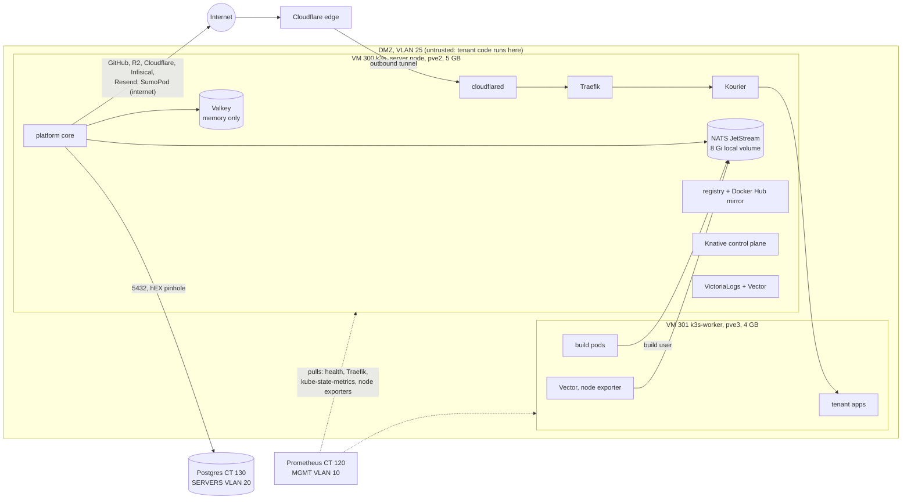

# Kubeletto on the home server: architecture

As built on 2026-10-14 (the day of the cutover), what is wrong or missing, and
the target. Decisions are ADRs; this is the picture they refer to
([0004](../decisions/0004-public-ingress-cloudflare-tunnel.md),
[0010](../decisions/0010-shared-postgres-and-app-standard.md),
[0011](../decisions/0011-kubeletto-on-the-home-cluster.md),
[0015](../decisions/0015-tenant-capacity-by-measured-reservations.md)).
The migration runbooks are `kubeletto-migration.md` and `kubeletto-cutover.md`.

## 1. Zones and who sits where

Kubeletto runs strangers' code. The design rule is that the code of a tenant can
only ever reach the internet, and never the lab, the platform or its secrets.

| Zone | What | Why there |
| --- | --- | --- |
| Tenant plane: `k3s-worker` (pve3) | tenant apps, builds, two daemons | the only node that runs tenant code; a separate VM is the isolation boundary |
| Platform plane: `k3s` (pve2) | core and its secrets, NATS, Valkey, registry, edge (Traefik, Knative, tunnel) | everything that needs the Kubernetes API; tainted so no tenant pod lands here, default-deny ingress in every platform namespace |
| Data plane: CT 130 (pve2, VLAN 20) | Postgres, the one durable store | lab standard (ADR 0010): outside the DMZ, backed up, monitored |
| Ops plane: CT 120/121 (VLAN 10) | Prometheus, Grafana, logs | pulls only; the DMZ never pushes into MGMT |

Durable state is only: Postgres (PBS nightly, restore tested 29 s), the registry's
blobs (a dedicated disk of VM 300, no backup: ADR 0021), the SOPS secrets, and the Infisical project (tenant
env keys, SaaS). NATS and Valkey are not durable state: NATS is a transport (the
outbox lives in Postgres), Valkey holds locks, rate limits and caches.

## 2. What is weak today (checked, not assumed)

1. ~~Server and worker share VLAN 25 with allow-all VM firewalls.~~ Fixed
   2026-10-15: both VMs' Proxmox firewalls are inbound allow-lists built
   from what conntrack showed (`proxmox/opentofu/firewall.tf`). From the
   worker only the server's API (6443) and VXLAN answer; its kubelet (10250),
   node exporter (9100) and NodePorts no longer do. The server reaches the
   worker's kubelet and VXLAN only; the monitoring host its scrape ports and
   ping.
2. **Monitoring of the platform's parts:** partly fixed 2026-10-15. Every
   platform pod (registry, NATS, Valkey, core, Traefik, Kourier, Knative,
   cloudflared, logs) alerts when not ready, stuck (crash loop, image pull,
   missing config) or restarting (`k8s-platform` in `k8s.yml`). NATS's
   storage and consumer backlog are watched once Kubeletto uses the shared
   hub (`app-nats.yml`). The public path, including the registry's token
   endpoint (the 2026-10-14 cutover case), is probed from the internet
   (`KubelettoPublicPathDown`). Not covered: token signing itself (needs a
   credential), and registry retention (dry run:
   `docs/experiments/2026-10-15-registry-retention-dry-run.md`).
3. ~~Recovery of VM 300 is not tested.~~ Tested 2026-10-15: the nightly backup
   restored in 106 s to a NIC-less copy whose API server came up and decrypted
   the secrets (`docs/runbooks/backup-restore.md`). Still untested: a full
   cut-over to a restored VM 300 with its pods.
4. **One server node, on pve2.** pve2 also holds Postgres and the monitoring: a pve2
   failure takes the platform, the data and the alerting down together. No
   hardware can be added (budget): the answer is a fast, rehearsed recovery, not HA.
5. **State inside the DMZ VM.** NATS's volume lives on VM 300's disk, in the zone
   where tenant code runs. Low impact (it is only a transport, 0.8 MB), but it is
   not how the lab treats shared infrastructure (ADR 0010).

## 3. Options

| | What | Gain | Cost / risk |
| --- | --- | --- | --- |
| **A. Harden and prove what we have** (recommended) | PVE firewall between the VMs (worker to server: tcp 6443 and udp 8472 only; server to worker: tcp 10250 and udp 8472); NATS, Valkey, registry and core-flow metrics and alerts; a VM 300 restore drill; this document as the runbook | closes 1 to 3 at almost no cost, no hardware, no change to how the platform runs | firewall rules can break the overlay network if wrong: staged with an instant off switch |
| B. Move NATS and Valkey out to lab services | two small guests on pve2 in VLAN 20 with monitoring and PBS, like Postgres; hEX pinholes from both K3s nodes; `NATS_URL`/`REDIS_URL` change | state out of the DMZ, uniform with ADR 0010 | new pinholes (4222, 6379) from the zone that runs untrusted builds, extra RAM on pve2 (tight), a rework one day after a cutover; gains little because the state is transient |
| C. Control plane out of the DMZ | VM 300 moves to VLAN 20; the worker stays in the DMZ; the router (not the switch) is the boundary between them | the strongest isolation: tenant code in one VLAN, the platform and its secrets in a trusted one | re-IP of the K3s server (certificates, agent join, flannel), tenant traffic crosses the hEX (VXLAN), a rebuild of the cluster: the largest change, best done only if A leaves a real concern |

Recommendation: **A now**, C only if a threat model for a compromised worker VM
justifies a cluster rebuild, B not unless NATS or Valkey ever becomes durable.

## 4. Failure modes (what happens, and the way back)

| Fails | Effect | Way back |
| --- | --- | --- |
| pve3 | tenant apps down; platform, API, console up | pve3 back; the worker rejoins by itself (proven by the reboot test) |
| pve2 | everything: platform, Postgres, monitoring | pve2 back (guests start on boot, proven 2026-10-14); cluster Ready within ~3 min |
| VM 300 lost | platform down, tenants keep serving until pods restart | restore from PBS (nightly; drill 2026-10-15: 106 s, state and secrets intact); or rebuild from the repo + the database + the secrets snapshot (`apply.sh`, `secrets.sh --from-snapshot`, `restore.sh`) |
| NATS lost | in-flight events lost, streams recreated empty | restart; the outbox in Postgres is the source |
| Valkey lost | locks and rate limits reset | none needed |
| Postgres lost | platform down | PBS restore (29 s, proven) |
| Rented server (until 2026-11-05) | none | it is the rollback, `flip.sh back` |
| A build cache | that service's next build is cold | none needed; the next build refills it |

## 5. Builds

A push to a connected GitHub repo queues a build; core's scheduler runs at
most 3 at once and 1 per service, each as a Job in `kubeletto-builds` on the
worker: rootless BuildKit (no privileges) clones, builds and pushes to the
in-cluster registry (its blobs on VM 300's own disk, ADR 0021). Docker Hub base images come through the
pull-through mirror on the server (20 Gi local volume). Build pods reach only
DNS, the internet on 80/443, the registry, NATS and core's internal API
(`allow-build-egress`), never the lab.

Since 2026-10-14 the three most recently built services keep BuildKit's
cache between builds, on a claim of their own on the worker (never shared
between services: a cache must not answer another tenant's build). Measured on
the worker: a Go build 128 s cold, 6 s warm. Disk bounds:
`services/k3s/README.md` (the worker's disk budget).
